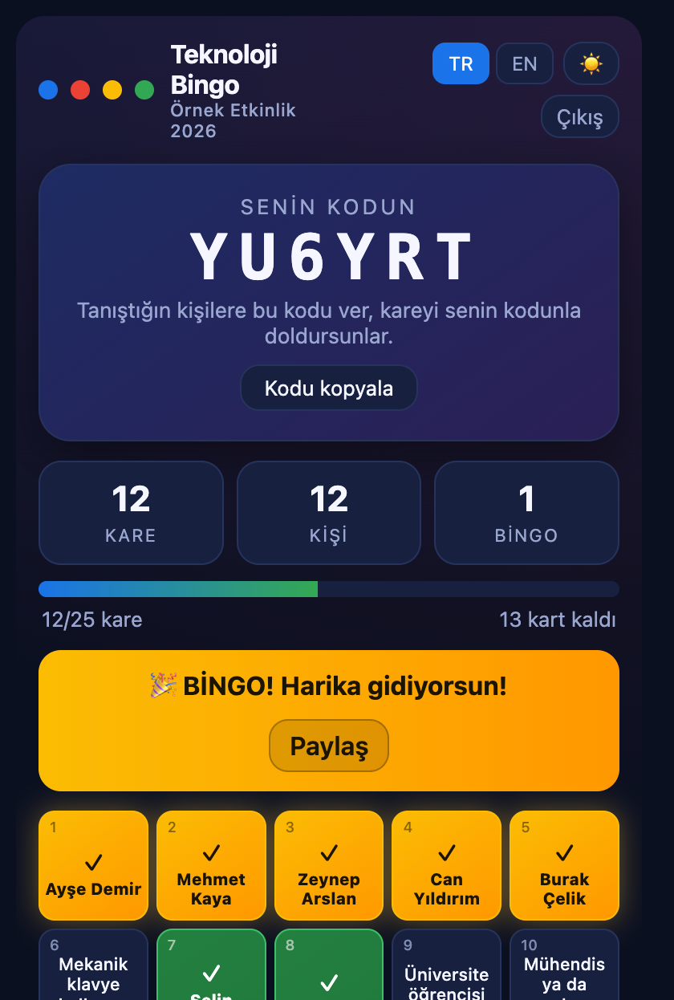
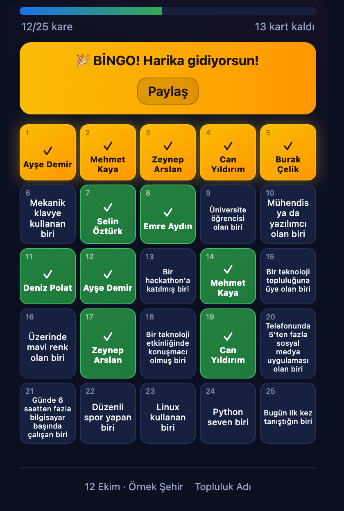
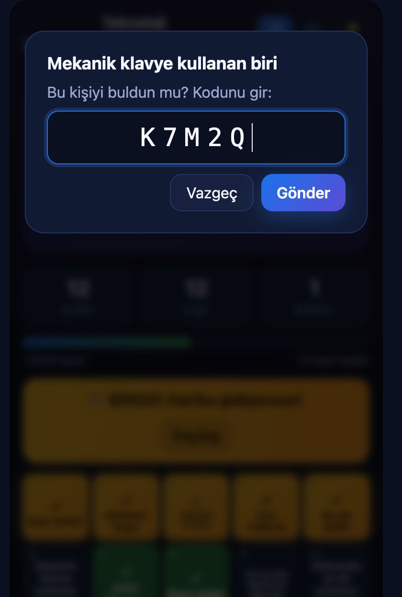
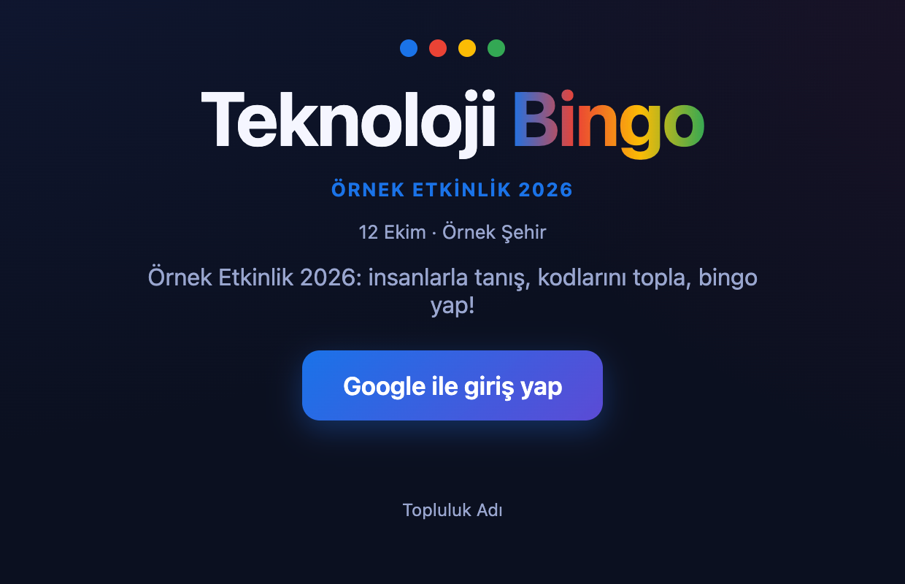
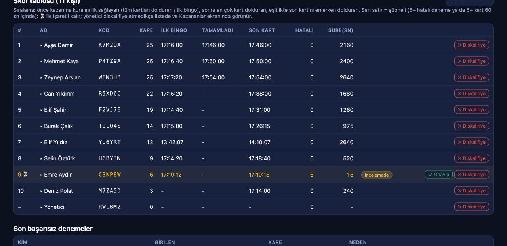
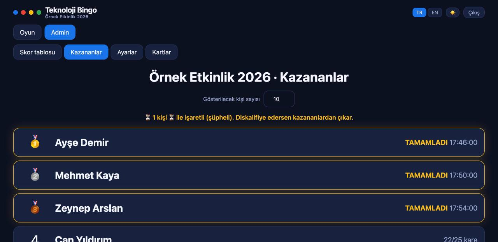

# 🎯 Teknoloji Bingo

Etkinliklerde katılımcıların birbiriyle tanışmasını sağlayan, Firebase tabanlı bir bingo oyunu.

Herkes **Google ile giriş yapar** ve kendine ait kişisel bir **kod** alır. Tahtadaki kartları ("5 yıldır gözlük takan biri", "DevFest'te konuşmacı olan biri"…) doldurmak için o kişiyi bulur, tanışır ve **onun kodunu** girer. Doğrulama otomatiktir ve sunucu tarafında zorlanır: kod gerçekten var mı, kendi kodun mu, aynı kişi en fazla kaç kartta kullanıldı. Böylece rastgele kod yazanlar ile gerçekten insanlarla tanışanlar ayırt edilebilir.

> 🇬🇧 **English summary:** a Firebase-powered icebreaker bingo for events. Everyone signs in with Google and gets a personal code. To fill a square you find the matching person and enter *their* code. Validation is automatic and enforced by Firestore security rules. Includes an admin dashboard, winner screen, suspicious-activity review, TR/EN UI and runs on Firebase's free plan. See the [English quick start](#-english-quick-start) at the bottom.

---

## İçindekiler

- [Ekran görüntüleri](#-ekran-görüntüleri)
- [Nasıl oynanır?](#-nasıl-oynanır)
- [Özellikler](#-özellikler)
- [Teknoloji](#-teknoloji)
- [Proje yapısı](#-proje-yapısı)
- [Kurulum: sıfırdan canlıya](#-kurulum-sıfırdan-canlıya)
- [Yerelde çalıştırma](#-yerelde-çalıştırma)
- [Canlıya alma ve güncelleme](#-canlıya-alma-ve-güncelleme)
- [Etkinlik günü rehberi](#-etkinlik-günü-rehberi)
- [Yapılandırma](#-yapılandırma)
- [Veri modeli](#-veri-modeli)
- [Güvenlik modeli](#-güvenlik-modeli)
- [Testler](#-testler)
- [Maliyet ve kotalar](#-maliyet-ve-kotalar)
- [Sorun giderme](#-sorun-giderme)
- [Yol haritası](#-yol-haritası)
- [Katkıda bulunanlar](#-katkıda-bulunanlar)

---

## 📸 Ekran görüntüleri

> Görüntülerdeki tüm kişiler ve veriler **uydurmadır** (yerel emülatörde hazırlanmıştır).

<table>
  <tr>
    <td align="center"><br><sub>Oyuncu ekranı</sub></td>
    <td align="center"><br><sub>Bingo tahtası</sub></td>
    <td align="center"><br><sub>Kod giriş penceresi</sub></td>
  </tr>
</table>

<p align="center"><br><sub>Giriş ekranı</sub></p>

**Yönetici paneli**


<sub>Skor tablosu: canlı sıralama, şüpheli işareti (⏳) ve onayla / diskalifiye düğmeleri</sub>


<sub>Kazananlar ekranı (projeksiyon için): gösterilecek kişi sayısı seçilebilir</sub>

---

## 🎮 Nasıl oynanır?

1. Oyuncu siteyi açar, **Google ile giriş yapar** ve ekranda kendine ait 6 karakterlik kodu görür.
2. Tahtadaki bir karta dokunur (örn. *"Gözlük takan biri"*), etkinlikte o özelliğe uyan birini bulur.
3. O kişi kendi kodunu söyler ya da gösterir, oyuncu kodu girer.
4. Kod geçerliyse kare dolar ve kişinin adı karede görünür.
5. **Kazanma kuralı** (yöneticinin seçimine bağlı):
   - **Tüm kartları ilk dolduran kazanır** (varsayılan), ya da
   - **İlk bingoyu** (satır, sütun, çapraz) yapan kazanır.

Kurallar:

- Kendi kodunu giremezsin.
- Aynı kişinin kodunu en fazla **N** kartta kullanabilirsin (varsayılan 4, yönetici değiştirir).
- Bir kare yalnızca bir kez doldurulabilir.

## ✨ Özellikler

### Oyuncular için
- Google ile tek tıkla giriş, her kullanıcıya **benzersiz kod**
- Türkçe / İngilizce arayüz, açık / koyu tema, mobil uyumlu tasarım
- İlerleme çubuğu, "bingoya N kart kaldı" bilgisi, bingo / tamamlama animasyonu (konfeti) ve paylaşım
- Kod giriş penceresi telefon klavyesinin üstünde kalacak şekilde konumlanır
- Uygulama içi tarayıcı (Instagram, WhatsApp…) algılama uyarısı

### Yönetici paneli
- **Skor tablosu:** tamamlama / ilk bingo saatine göre canlı sıralama, hatalı deneme sayıları
- **Şüpheli kullanıcı işareti:** 5+ hatalı deneme ya da 5+ kartı 60 saniyeden kısa sürede doldurma
- **İnceleme akışı:** isme tıklayınca kullanıcının tüm doldurmaları ve hatalı denemeleri görünür; **Onayla / Diskalifiye / Geri al**
- **Kazananlar ekranı:** projeksiyona uygun, madalyalı büyük liste; gösterilecek kişi sayısını yönetici seçer
- **CSV dışa aktarma** (Excel'de Türkçe karakterler bozulmaz)
- **Etkinlik ayarları:** etkinlik adı, tarih/yer, alt yazı, vurgu rengi, kişi başı limit, kazanma kuralı, oyun açık/kapalı, otomatik başlangıç ve bitiş saati
- **Kart yönetimi:** sınırsız kart, tek tek ya da toplu ekleme (`Türkçe | English`), sıralama, düzenleme, silme
- **Sıfırlama:** yalnızca oyunu sıfırla (kullanıcılar kalsın) ya da her şeyi sıfırla; onay kelimesi ister

### Güvenlik ve doğrulama
- Tüm kurallar **Firestore güvenlik kurallarında** zorlanır; tarayıcıyı değiştirerek atlatılamaz
- Kod listesi çalınamaz (kodlar tek tek sorgulanır, listelenemez)
- Sayaç geri sarma, dolu kareyi ezme, başkası adına yazma, eşzamanlı (yarış) istekler engellenir
- Hatalı denemeler kayıt altına alınır
- **87 güvenlik testi + 59 birim testi** (aşağıya bakın)

## 🧰 Teknoloji

| Katman | Kullanılan |
|---|---|
| Arayüz | React 19 + Vite (kütüphanesiz saf CSS) |
| Kimlik doğrulama | Firebase Authentication (Google) |
| Veritabanı | Cloud Firestore (gerçek zamanlı dinleyiciler) |
| Barındırma | Firebase Hosting |
| Testler | Node + `@firebase/rules-unit-testing` + Firebase Emulator Suite |

Cloud Functions **kullanılmaz**: tüm doğrulama güvenlik kurallarıyla yapılır, bu yüzden ücretsiz **Spark** planında çalışır.

## 📁 Proje yapısı

```
.
├── src/
│   ├── App.jsx               # giriş ekranı, başlık, sekmeler, tema
│   ├── components/
│   │   ├── Board.jsx         # oyuncu tahtası, kod giriş penceresi
│   │   ├── Admin.jsx         # skor tablosu, kazananlar, ayarlar, kartlar
│   │   └── Confetti.jsx      # kütüphanesiz konfeti
│   ├── logic.js              # saf oyun mantığı (bingo, tamamlama, kod üretimi…), Node'da test edilir
│   ├── game.js               # Firestore işlemleri (kayıt, kart doldurma)
│   ├── settings.js           # canlı etkinlik ayarları
│   ├── i18n.jsx, i18n-dict.js# Türkçe / İngilizce çeviriler
│   ├── firebase.js           # Firebase başlatma (+ emülatör bağlantısı)
│   └── styles.css
├── firestore.rules.template  # güvenlik kuralları şablonu (admin e-postası yer tutucu)
├── scripts/build-rules.mjs   # şablondan firestore.rules üretir
├── test/                     # birim, güvenlik ve yük testleri
├── firebase.json             # Hosting + Firestore + emülatör ayarları
├── .env.example              # ortam değişkenleri şablonu
└── .firebaserc.example       # Firebase proje kimliği şablonu
```

---

## 🚀 Kurulum: sıfırdan canlıya

### Gereksinimler

- **Node.js 20.19+ veya 22.12+** (22 ile test edildi) ve npm
- Bir **Google hesabı** (Firebase için)
- **Firebase CLI:** `npm install -g firebase-tools`
- Emülatörle test etmek isterseniz **Java (JDK)**

### 1) Firebase projesi oluşturun

1. [Firebase konsolunda](https://console.firebase.google.com) **Proje ekle** deyin (Analytics gerekmez).
2. **Build → Authentication → Get started → Sign-in method → Google**'ı etkinleştirin, bir destek e-postası seçin ve kaydedin.
3. **Build → Firestore Database → Create database**: konumu seçin (örn. `eur3`) ve **production mode** ile oluşturun. Kuralları deploy adımında biz yükleyeceğiz.
4. **Proje ayarları → Genel → Uygulamalarınız → Web (`</>`)** ile bir web uygulaması ekleyin. Görünen yapılandırma değerlerini (apiKey, authDomain, …) bir kenara not edin.

> Konsolda "Cloud Firestore API has not been used…" benzeri bir hata görürseniz, hatadaki bağlantıdan API'yi etkinleştirip birkaç dakika bekleyin.

### 2) Projeyi indirip yapılandırın

```bash
git clone <depo-adresi>
cd <klasör>
npm install

cp .env.example .env
cp .firebaserc.example .firebaserc
```

`.env` dosyasını doldurun:

```env
VITE_FIREBASE_API_KEY=...
VITE_FIREBASE_AUTH_DOMAIN=proje-kimliginiz.firebaseapp.com
VITE_FIREBASE_PROJECT_ID=proje-kimliginiz
VITE_FIREBASE_STORAGE_BUCKET=proje-kimliginiz.firebasestorage.app
VITE_FIREBASE_MESSAGING_SENDER_ID=...
VITE_FIREBASE_APP_ID=...
VITE_ADMIN_EMAIL=siz@ornek.com        # Admin paneline girecek Google hesabı
```

`.firebaserc` dosyasındaki `your-firebase-project-id` yerine kendi proje kimliğinizi yazın. Her iki dosya da `.gitignore` içindedir, git'e eklenmez.

### 3) Firebase CLI ile giriş yapın

```bash
firebase login
```

### 4) Canlıya alın

```bash
npm run deploy
```

Bu komut sırasıyla:
1. `firestore.rules.template` dosyasından, `.env` içindeki `VITE_ADMIN_EMAIL` ile **`firestore.rules`** üretir,
2. siteyi derler (`dist/`),
3. Firestore kurallarını ve Hosting'i yayınlar.

Bitince terminalde `Hosting URL: https://proje-kimliginiz.web.app` adresini görürsünüz. Oyunculara bu adresi verin.

### 5) İlk yönetici kurulumu

1. Siteyi açın ve **`VITE_ADMIN_EMAIL` ile aynı Google hesabıyla** giriş yapın (e-posta doğrulanmış olmalı). Üstte **Admin** sekmesi belirir.
2. **Admin → Kartlar → "Örnek 25 kartı ekle"** deyin ya da kendi kartlarınızı yazın.
3. **Admin → Ayarlar**'dan etkinlik adını, tarih/yer bilgisini, kazanma kuralını ve limitleri belirleyip **Kaydet** deyin.
4. İkinci bir Google hesabıyla (ya da telefondan) girip bir kart doldurarak sistemi deneyin.

### Özel alan adı kullanacaksanız

Hosting'e alan adı bağladıktan sonra **Authentication → Settings → Authorized domains** listesine o alan adını da ekleyin. Eklemezseniz Google girişi o adreste hata verir.

---

## 💻 Yerelde çalıştırma

İki yol var:

### A) Gerçek Firebase projenize bağlı (hızlı)

```bash
npm run dev
```

`http://localhost:5173` açılır. **Dikkat:** gerçek projenize yazdığınız her şey gerçek veritabanına gider. `localhost`, Firebase'in yetkili alan adlarında varsayılan olarak tanımlıdır.

### B) Emülatörle, gerçek veriye dokunmadan (önerilen)

Birinci terminal:

```bash
npm run emulators
```

İkinci terminal:

```bash
npm run dev:emulator
```

Terminalde yazan adresi açın (genelde `http://127.0.0.1:5173`). Emülatör modunda:

- Auth ve Firestore **yerel emülatörde** çalışır, hiçbir bulut verisi etkilenmez.
- Admin e-postası `admin@example.com` olur (`npm run emulators` kuralları bu e-postayla üretir).
- Tarayıcı konsolunda `await window.__test.signIn("a@b.com", "Ali")` ile sahte Google hesabıyla giriş yapabilirsiniz (popup gerekmez). Bu yardımcı üretim derlemesine **girmez**.

Not: Emülatörle çalıştıktan sonra `firestore.rules` dosyası örnek e-postayla üretilmiş olur; `npm run deploy` her seferinde dosyayı `.env` değerinizle yeniden ürettiği için canlıya yanlış kural gitmez.

---

## 🔄 Canlıya alma ve güncelleme

| İş | Komut |
|---|---|
| Her şeyi yayınla (kurallar + site) | `npm run deploy` |
| Sadece site | `npm run build && firebase deploy --only hosting` |
| Sadece kurallar | `npm run rules:build && firebase deploy --only firestore` |
| Kuralları yerelde üret | `npm run rules:build` |

Ana sayfa önbelleğe alınmaz (`Cache-Control: no-cache`), güncellemeyi oyuncular sayfayı yenileyince görür. Sürüm kodlu dosyalar uzun süre önbellekte kalır.

> ⚠️ Etkinlik sürerken yayın yapmaktan kaçının. Kart metinleri ve ayarlar veritabanından geldiği için **kod yayınlamadan** Admin panelinden değiştirilebilir.

---

## 📋 Etkinlik günü rehberi

**Etkinlikten önce**
- [ ] Kartları yazın (kitleye uygun, çoğu kolay, birkaçı zor). Katılımcı sayısı kart sayısının en az 3 katı olsun.
- [ ] Ayarlarda etkinlik adını, kazanma kuralını ve kişi başı limiti seçin.
- [ ] Test verisini temizleyin: **Ayarlar → Her şeyi sıfırla** (`TAMAMEN` yazın).
- [ ] Bir telefondan gerçek bir tur oynayın (giriş, kod girme, klavye konumu).
- [ ] İsterseniz **başlangıç / bitiş saatini** ayarlayın; saat dolunca kart doldurma otomatik kapanır.
- [ ] Oyun linkini QR koda çevirip afişe / slayta koyun.

**Etkinlik sırasında**
- Katılımcılara linki **kendi tarayıcılarında** (Chrome / Safari) açmalarını söyleyin; WhatsApp / Instagram içi tarayıcıda Google girişi çalışmayabilir.
- "Kodunu yazıyla paylaşma, karşındakine göster" diye duyurun.
- **Admin → Skor tablosu**'nu çok sık yenilemeyin, her açılış tüm doldurmaları okur (okuma kotası).

**Etkinlikten sonra**
- **Admin → Skor tablosu**'nda ⏳ işaretli kişilere bakın: isme tıklayıp doldurmalarını inceleyin, **Onayla** ya da **Diskalifiye** edin.
- **Kazananlar** sekmesinden gösterilecek kişi sayısını seçip ekranı projeksiyona yansıtın.
- **CSV indir** ile sonuçları saklayın.
- Oyunu kapatmak için **Ayarlar → Oyun açık** kutusunu kapatın.
- Kişisel verilerin silinmesi gerekiyorsa **Her şeyi sıfırla** kullanın.

---

## ⚙️ Yapılandırma

### Ortam değişkenleri (`.env`)

| Değişken | Açıklama |
|---|---|
| `VITE_FIREBASE_API_KEY` | Firebase web uygulaması API anahtarı |
| `VITE_FIREBASE_AUTH_DOMAIN` | `<proje>.firebaseapp.com` |
| `VITE_FIREBASE_PROJECT_ID` | Firebase proje kimliği |
| `VITE_FIREBASE_STORAGE_BUCKET` | Storage bucket adı |
| `VITE_FIREBASE_MESSAGING_SENDER_ID` | Gönderen kimliği |
| `VITE_FIREBASE_APP_ID` | Web uygulaması kimliği |
| `VITE_ADMIN_EMAIL` | Yönetici Google hesabı. Hem arayüzde admin sekmesini açar hem de güvenlik kurallarına yazılır |

### Etkinlik ayarları (Admin → Ayarlar, `config/settings`)

| Ayar | Açıklama | Varsayılan |
|---|---|---|
| Etkinlik adı / Tarih ve yer / Alt yazı | Giriş ekranı, başlık ve alt kısımda görünür | boş |
| Vurgu rengi | Düğme ve vurgu rengi (yazı rengi kontrasta göre otomatik seçilir) | `#1a73e8` |
| Kişi başı limit | Bir kişinin kodu en fazla kaç kartta kullanılabilir (1–25) | 4 |
| Kazanma kuralı | `full` = tüm kartlar, `line` = ilk bingo | `full` |
| Oyun açık | Kapalıyken kimse kart dolduramaz | açık |
| Başlangıç / bitiş saati | Boşsa zaman sınırı yok; sınırlar sunucuda da uygulanır | yok |
| Gösterilecek kişi sayısı | Kazananlar ekranındaki liste uzunluğu (1–100) | 10 |

### Kart sayısı ve tahta

Tahta kart sayısına göre otomatik şekillenir (9 → 3×3, 16 → 4×4, 20 → 5×4, 25 → 5×5). "İlk bingo" kuralında yalnızca tam dolu satır/sütun, kart sayısı tam kare ise (9, 16, 25) çaprazlar da sayılır.

---

## 🗄️ Veri modeli

| Yol | İçerik |
|---|---|
| `users/{uid}` | `code`, `name`, `email`, `photoURL`, `createdAt` (yalnızca sahibi ve admin okur) |
| `codes/{code}` | `uid`, `name`, `photoURL` (tek tek okunur, listelenemez) |
| `users/{uid}/claims/{squareId}` | doldurulan kart: `code`, `targetUid`, `targetName`, `createdAt` |
| `users/{uid}/met/{targetUid}` | bu kişinin kodu kaç kartta kullanıldı: `count`, `lastSquareId` |
| `squares/{id}` | `text`, `textEn`, `order` |
| `config/settings` | etkinlik ayarları (herkes okur, yalnızca admin yazar) |
| `attempts/{id}` | başarısız denemeler (yalnızca admin okur) |
| `reviews/{uid}` | yönetici kararı: `cleared` / `disqualified` (yalnızca admin) |

## 🔐 Güvenlik modeli

- **Doğrulama istemcide değil, Firestore kurallarındadır.** Kart doldurma tek bir `batch` içinde `claim` + `met` yazar; kurallar `getAfter` / `existsAfter` ile ikisinin tutarlılığını, kodun gerçekten hedef kişiye ait olduğunu, kendi kodun olmadığını, sayacın tam +1 arttığını ve limitin aşılmadığını denetler.
- Admin yetkisi `firestore.rules.template` içindeki e-posta + `email_verified` kontrolüyle verilir. Şablondaki `__ADMIN_EMAIL__` yer tutucusu `npm run rules:build` ile doldurulur.
- Firebase web yapılandırması (API anahtarı dahil) tarayıcıda herkese açıktır, bu normaldir. Veriyi koruyan şey kurallardır: **kuralları yalnızca kendi projenize deploy edin.**
- Kod fotoğrafla ya da mesajla paylaşılabilir; sistem yüz yüze tanışmayı kanıtlayamaz. Şüpheli işareti ve yönetici incelemesi bunu azaltmak içindir.
- **Kişisel veri:** uygulama Google hesabından ad, e-posta ve fotoğraf saklar. Kendi etkinliğiniz için KVKK / GDPR bilgilendirmesini eklemeyi unutmayın. **Her şeyi sıfırla** tüm kullanıcı verisini siler.

## 🧪 Testler

```bash
npm test               # birim + güvenlik kuralları
npm run test:unit      # bingo mantığı, kod üretimi, çeviriler, renk kontrastı (59 test)
npm run test:rules     # Firestore güvenlik kuralları emülatörde (87 test)
npm run test:load      # 200 kullanıcı, 5000 kart doldurma, 600 hile denemesi
```

Güvenlik testleri şunları kapsar: girişsiz erişim, başkasının verisini okuma / yazma, kod ele geçirme, sahte alanlar ve tarih, sayaç manipülasyonu, eşzamanlı istekler, admin yetkisi, ayar doğrulaması, zamanlı açılış/kapanış ve inceleme akışı.

> Firestore emülatörü için Java gerekir. Testler `demo-*` proje kimlikleriyle çalışır, gerçek projenize dokunmaz.

## 💸 Maliyet ve kotalar

Firebase **Spark (ücretsiz)** planı yeterlidir ve limit aşılırsa **faturalamaz**, yalnızca işlemleri durdurur.

| Kaynak | Günlük ücretsiz kota | 200 kişilik etkinlikte tahmini kullanım |
|---|---|---|
| Firestore okuma | 50.000 | ~20.000 – 45.000 (herkes tüm kartları doldurursa) |
| Firestore yazma | 20.000 | ~10.400 |
| Hosting aktarım | ~360 MB | ~50 MB |

Admin panelini sürekli açık bırakmak okumayı artırır. Daha büyük etkinlikler için **Blaze** (kullandıkça öde) planına geçilebilir, ücretsiz kota aynıdır.

## 🛠️ Sorun giderme

| Sorun | Çözüm |
|---|---|
| `Missing or insufficient permissions` | Kuralları deploy ettiniz mi? `npm run deploy`. Admin e-postası `.env` ile doğru mu? |
| Giriş penceresi açılmıyor / `auth/popup-blocked` | Tarayıcıda açılır pencerelere izin verin. |
| `auth/cancelled-popup-request` | Giriş düğmesine iki kez basıldı; uygulama artık bunu sessizce yönetir. |
| WhatsApp / Instagram içinde giriş çalışmıyor | Linki Chrome / Safari'de açın. |
| Özel alan adında giriş hatası | Authentication → Settings → **Authorized domains**'e ekleyin. |
| `Cloud Firestore API has not been used…` | Hatadaki bağlantıdan API'yi etkinleştirin, birkaç dakika bekleyin. |
| Admin sekmesi görünmüyor | Admin e-postasıyla giriş yaptınız mı? Google e-postası doğrulanmış olmalı ve `VITE_ADMIN_EMAIL` ile birebir aynı olmalı. |
| Site eski görünüyor | Sayfayı yenileyin (ana sayfa önbelleğe alınmaz). |
| Emülatör başlamıyor | Java (JDK) kurulu mu? Portlar `9099` (Auth) ve `8080` (Firestore) boş mu? |

## 🗺️ Yol haritası

- [ ] QR kod ile kod okutma (elle yazmak yerine)
- [ ] Belli aralıklarla değişen kodlar (kod paylaşımına karşı)
- [ ] Oyuncular için canlı sıralama
- [ ] Admin listesini veritabanında tutma (birden fazla yönetici)
- [ ] GitHub Actions ile otomatik test
- [ ] Admin panelinde okuma sayısını azaltan sayaçlar

## 🤝 Katkıda bulunanlar

<!-- Kendi GitHub kullanıcı adınızı ve rolünüzü bu listenin başına ekleyin. -->
- [**@ArdaEnes824**](https://github.com/ArdaEnes824): geliştirme sürecinde katkı sağladı ve yardımcı oldu. Teşekkürler! 🙌

Katkı vermek isterseniz bir **issue** açın ya da **pull request** gönderin. Gönderiminizden önce `npm test` komutunun geçtiğinden emin olun.

---

## 🇬🇧 English quick start

```bash
# prerequisites: Node.js 20.19+ or 22.12+, a Google account, Firebase CLI (npm i -g firebase-tools)
git clone <repo-url> && cd <folder>
npm install
cp .env.example .env                 # fill in your Firebase web config + VITE_ADMIN_EMAIL
cp .firebaserc.example .firebaserc   # put your Firebase project id
firebase login
npm run deploy                       # builds rules from the template, builds the site, deploys rules + hosting
```

1. In the Firebase console create a project, enable **Authentication → Google**, create a **Firestore** database (production mode) and add a **Web app** to get the config values.
2. Open the deployed site, sign in with the account set in `VITE_ADMIN_EMAIL` and use **Admin → Squares → Add 25 sample squares**, then tweak **Admin → Settings**.
3. Local development: `npm run dev` (real project) or `npm run emulators` + `npm run dev:emulator` (safe, no cloud data).
4. Tests: `npm test` (unit + security rules on the emulator).
5. If you use a custom domain, add it to **Authentication → Settings → Authorized domains**.

**How it works:** every user gets a unique 6-character code; filling a square requires another person's code. All checks (code exists, not your own, per-person usage limit, game open/closed, time window) run in Firestore security rules, so they cannot be bypassed from the browser. Cloud Functions are not needed, so it fits Firebase's free Spark plan.
